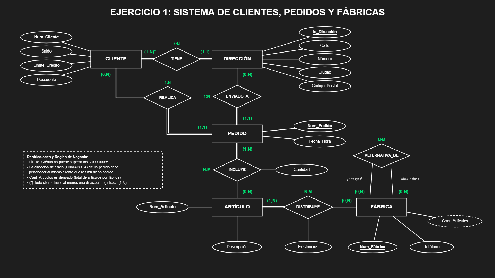
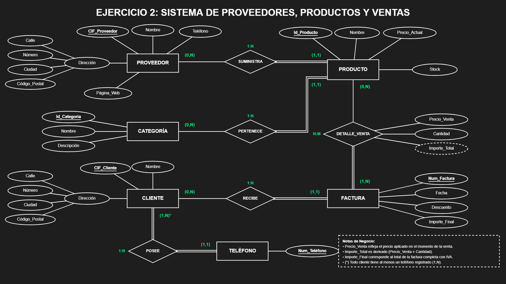
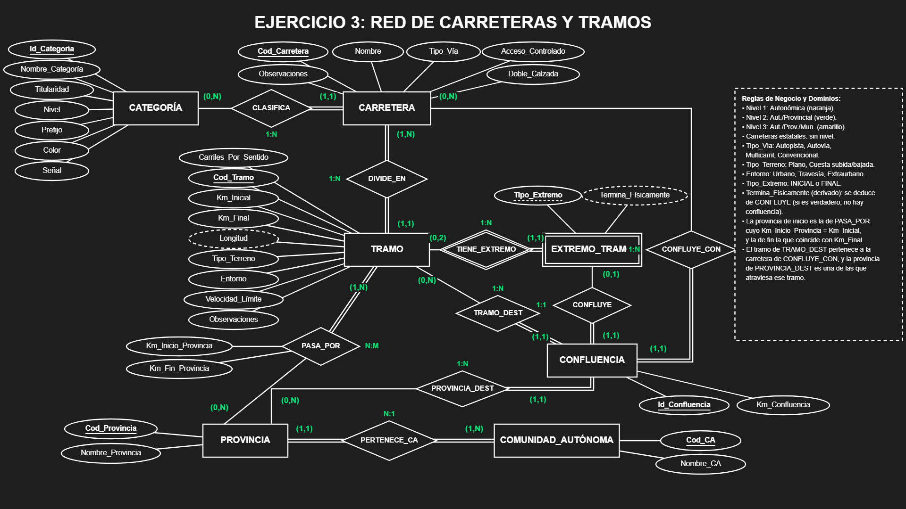
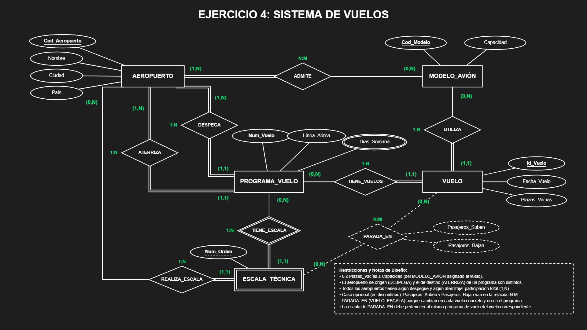

# 🗄️ Curso de Bases de Datos: MySQL

Bienvenido al repositorio de estudio y ejercicios prácticos sobre Bases de Datos Relacionales. Este material está estructurado en diferentes módulos que cubren desde el diseño conceptual hasta la programación avanzada en el motor de base de datos.

---

## 📚 Unidades Formativas (UFs)

<b>UF01. Introducción y Diseño de Bases de Datos Relacionales (30 Horas)</b>

 

### 1. Introducción a los Sistemas de Bases de Datos y Fases del Diseño

**Resumen: Ciclo de vida de los datos (DLM)**
El Ciclo de Vida de los Datos (DLM) abarca todas las etapas por las que pasa un dato, desde su captura hasta su destrucción, para garantizar la seguridad y eficiencia. Las fases principales incluyen: creación/captura, almacenamiento, uso y procesamiento, compartición, archivo y destrucción. Además, se destaca la importancia de definir metadatos adecuados (descriptivos, estructurales y administrativos) para organizar la información y seguir normativas como el formato ISO 8601 para fechas.

**Resumen: Introducción a las Bases de Datos Relacionales**
Una base de datos es una colección lógicamente coherente de datos con significado implícito. El modelo relacional es el estándar para bases transaccionales porque evita la duplicidad de registros y garantiza la integridad de los datos mediante el uso de tablas. Un Sistema Gestor de Bases de Datos (SGBD) es el conjunto de programas que permite definir, construir y manipular estos datos ocultando los detalles de almacenamiento al usuario. El diseño de una base de datos consta de cuatro fases: descripción de requisitos, diseño conceptual, diseño lógico y diseño físico.

**Ejercicios:**
*   [Ver los ejercicios resueltos del Ciclo de Vida de los Datos](src/Ejercicio1/ejercicios_del_ciclo_de_vida_de_los_datos.md): Casos prácticos de "La tienda de ropa de Ana" y "Rutas Eficientes S.A.".

---

### 2. Diseño Conceptual. Diagrama Entidad-Relación

**Resumen del temario**
El diseño conceptual sirve para plasmar los requisitos de los usuarios en un esquema comprensible llamado Diagrama Entidad-Relación. Este modelo se basa en **Entidades** (objetos o elementos con características comunes), **Atributos** (propiedades de esas entidades, incluyendo atributos "identificadores" únicos), y **Relaciones** (asociaciones entre dos o más entidades). Las relaciones poseen una **Cardinalidad** que define el número de ocurrencias asociadas (1:1, 1:N, o N:M).

**Ejercicios Resueltos (Modelo Entidad/Relación):**
A continuación se presentan las soluciones en Diagrama Entidad-Relación para los casos de estudio planteados:

[Diagramas en HTML](src/Ejercicio2/DiagramasHTML.html)

1.  **Ejercicio 1: Artículos y encargos**
    *Solución:*
    

2.  **Ejercicio 2: Sistema de ventas**
    *Solución:*
    

3.  **Ejercicio 3: Carreteras**
    *Solución:*
    

4.  **Ejercicio 4: Sistema de vuelos**
    *Solución:*
    

---

### 3. Del Modelo Conceptual al Modelo Lógico. El Modelo Relacional

**Resumen: El Modelo Relacional y Reglas de Transformación**
El diseño lógico transforma el modelo conceptual abstracto en un conjunto de tablas comprensibles e implementables por un SGBD. Este proceso sigue unas reglas de paso fijas:
*   **Relaciones 1:1:** En la mayoría de los casos, se fusionan ambas entidades en una sola tabla.
*   **Relaciones 1:N:** La clave primaria de la entidad con cardinalidad 1 pasa como clave foránea a la entidad con cardinalidad "N".
*   **Relaciones N:M:** Se crea una nueva tabla intermedia cuya clave primaria es la concatenación de las claves primarias de las entidades asociadas.

**Resumen: La Matriz de Relaciones**
Es una herramienta en formato de tabla que ayuda a determinar de manera visual y clara cómo interactúan o dependen entre sí las distintas variables (entidades) de nuestro sistema.

**Ejercicios:**
*   **Ejercicio Práctico:** [Transformar los ejercicios resueltos 1 y 2 de la sesión del Modelo E/R (Artículos/Encargos y Sistema de Ventas) al Modelo Lógico Relacional aplicando las reglas de paso.](src/Ejercicio3/diseño_logico_ejercicio.md)

<b>UF02. Modelo Entidad-Relación y Normalización (30 Horas)</b>

 
*(Contenido por añadir)*

<b>UF03. Lenguaje de Definición de Datos (DDL) (40 Horas)</b>

 
*(Contenido por añadir)*

<b>UF04. Lenguaje de Manipulación de Datos (DML) (50 Horas)</b>

 
*(Contenido por añadir)*

<b>UF05. Programación de objetos de BBDD (Triggers y Store Procedures) (50 Horas)</b>

 
*(Contenido por añadir)*

