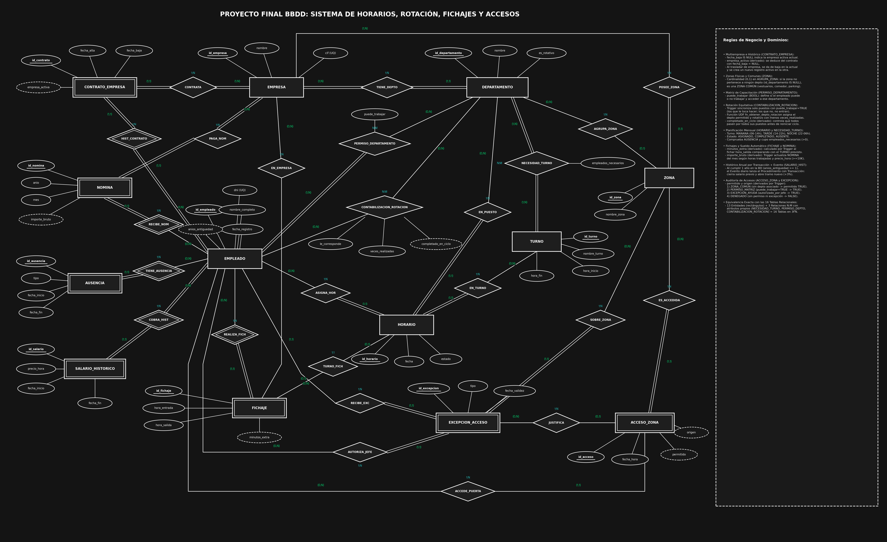

# 1. Identificación del proyecto: Nombre, Autor, Objetivo y URL de Github
Nombre: GestorHorariosUpgrade — Sistema Integral de Gestión de Horarios en Rotación, Fichajes, Nóminas y Auditoría de Accesos Multiempresa.

Autor: Rubén Burgués Torres

Objetivo: Desarrollar el sistema de base de datos relacional para gestionar y automatizar la planificación de horarios rotativos, el control de presencia (fichajes), el cálculo de nóminas con histórico salarial anual y el registro de accesos por sectores en un grupo empresarial, sustituyendo el sistema manual previo en hojas de cálculo (Excel) para aumentar la eficiencia operativa.

url: https://github.com/Ruben-Burgues-Torres/MySQL/edit/main/src/proyecto_final

# 2. Especificación de Requisitos
Requisitos de Información (Datos a almacenar)
De las empresas del grupo se debe registrar un código interno (único), el nombre de la razón social y el CIF (único).

De los departamentos (sectores de trabajo) se requiere un código interno (único), la empresa a la que pertenecen, el nombre del departamento y un indicador booleano (es_rotativo) que señale si el puesto entra en la rotación automática o es un puesto fijo.

De las zonas físicas de paso se necesita un código de zona (único), la empresa en la que se ubican, el nombre de la zona y el departamento al que están adscritas (pudiendo quedar vacío si se trata de una zona común como comedor, vestuarios o parking).

De los turnos de trabajo se debe almacenar el código de turno (único), el nombre del turno (mañana, tarde o noche), la hora de inicio y la hora de fin. Asimismo, se debe registrar cuántos empleados necesarios requiere cada departamento en cada turno.

De los empleados se requiere el código de empleado (único), DNI (único), nombre completo y la fecha de registro inicial en el sistema.

De los contratos por empresa (histórico laboral) se debe guardar un código de contrato (único), el empleado, la empresa contratante, la fecha de alta y la fecha de baja.

De las ausencias del personal se debe registrar un código de ausencia (único), el empleado, el tipo de ausencia (vacaciones, baja médica, permiso), la fecha de inicio y la fecha de fin.

De la matriz de permisos y la rotación se necesita saber para cada empleado y departamento si puede o no puede trabajar en él (puede_trabajar), así como contabilizar en los puestos que sí le corresponden el número de veces realizadas (veces_realizadas) y si ya ha completado ese puesto en el ciclo actual (completado_en_ciclo).

De los horarios planificados se debe registrar un código de horario (único), el empleado asignado, el departamento, el turno, la fecha y el estado del turno (ASIGNADO, COMPLETADO o AUSENTE).

De los fichajes diarios se debe almacenar un código de fichaje (único), el empleado, la empresa donde ficha, el horario asociado, la fecha y hora de entrada, la fecha y hora de salida, y los minutos extra generados en la jornada.

De los salarios históricos y las nóminas se requiere guardar para cada tramo salarial su código (único), el empleado, el precio por hora, la fecha de inicio y la fecha de fin de vigencia. Para cada nómina mensual se registrará su código (único), el empleado, la empresa pagadora, el año, el mes y el importe bruto acumulado.

De los accesos a zonas y sus excepciones se debe almacenar cada paso de un empleado por un sector con un código de acceso (único), el empleado, la zona, la fecha y hora del paso, un indicador booleano de si tenía permiso o no (permitido), el origen de la validación (origen) y, en caso de existir, la excepción asociada. De las excepciones puntuales se guardará un código de excepción (único), el empleado autorizado, la zona, el tipo o motivo de ayuda, la fecha de validez y el empleado responsable que lo autorizó (autorizado_por).

Reglas de Negocio (Restricciones y flujos)
Una empresa se divide en varios departamentos y posee múltiples zonas físicas; cada departamento y cada zona pertenecen a una única empresa.

Un departamento puede agrupar varias zonas físicas, pero una zona puede pertenecer a un solo departamento o a ninguno (NULL), considerándose en este último caso una zona común de libre acceso para los empleados de esa empresa.

Un empleado puede trabajar en varias empresas del grupo a lo largo del tiempo (registrado en su histórico de contratos). Cuando un empleado pasa de una empresa a otra, se le da de baja en la empresa actual (anotando su fecha_baja) y se le activa en la nueva empresa (dejando fecha_baja a NULL).

La matriz de capacitación define a qué departamentos tiene permiso para ir a trabajar un empleado (puede_trabajar = TRUE) y a cuáles no (FALSE).

En la tabla de contabilización de rotación entran únicamente los departamentos que al empleado sí le corresponde hacer (le_corresponde = TRUE). El generador automático de horarios asigna el departamento rotativo permitido donde el empleado acumule menos veces_realizadas, asegurando que todos pasen por todos sus puestos habilitados antes de reiniciar el ciclo.

Un empleado no puede tener asignados dos horarios en la misma fecha, ni ser asignado a un turno si tiene una ausencia activa en esa fecha.

Al fichar la hora de salida, el sistema calcula automáticamente los minutos_extra comparando el tiempo real con el turno previsto y actualiza el importe_bruto de la nómina mensual según el precio_hora vigente del trabajador (que en ningún caso puede ser inferior a 10,00 €).

Cuando un empleado cumple un año en la base de datos, se cierra automáticamente su tramo en el histórico de salarios (fecha_fin) y se abre un nuevo registro salarial actualizado.

Regla de acceso a sectores: Los empleados pueden acceder físicamente a todos los sectores/zonas de la empresa (ya sea por trabajo habitual, por paso o para prestar ayuda puntual), pero el sistema debe registrar en cada acceso si el trabajador tenía permiso (permitido = TRUE) —por ser zona común, estar habilitado en su matriz o contar con una excepción autorizada por un jefe para ese día— o si accedió sin permiso (permitido = FALSE), permitiendo contabilizar ambos casos por separado.

# 3. Diagrama Entidad-Relación (Modelo Conceptual)
A partir de los requisitos anteriores, identificamos las entidades, sus atributos y cómo se conectan entre sí:

Entidades y Atributos
Empresa: id_empresa (clave), nombre, cif (clave candidata).

Departamento: id_departamento (clave), nombre, es_rotativo.

Zona: id_zona (clave), nombre_zona.

Turno: id_turno (clave), nombre_turno, hora_inicio, hora_fin.

Empleado: id_empleado (clave), dni (clave candidata), nombre_completo, fecha_registro, anios_antiguedad (derivado).

Contrato_Empresa: id_contrato (clave), fecha_alta, fecha_baja, empresa_activa (derivado).

Ausencia: id_ausencia (clave), tipo, fecha_inicio, fecha_fin.

Salario_Historico: id_salario (clave), precio_hora, fecha_inicio, fecha_fin.

Nomina: id_nomina (clave), anio, mes, importe_bruto (derivado).

Horario: id_horario (clave), fecha, estado.

Fichaje: id_fichaje (clave), hora_entrada, hora_salida, minutos_extra (derivado).

Excepcion_Acceso: id_excepcion (clave), tipo, fecha_validez.

Acceso_Zona: id_acceso (clave), fecha_hora, permitido (derivado), origen (derivado).

Relaciones y Cardinalidades
Tiene_Depto (Empresa - Departamento): Relación 1:N. Una Empresa tiene muchos Departamentos; un Departamento pertenece a una sola Empresa.

Posee_Zona (Empresa - Zona): Relación 1:N. Una Empresa posee muchas Zonas físicas; una Zona se ubica en una sola Empresa.

Agrupa_Zona (Departamento - Zona): Relación 1:N. Un Departamento agrupa varias Zonas; una Zona pertenece como máximo a un Departamento (o a ninguno si es zona común, cardinalidad 0,1).

Necesidad_Turno (Departamento - Turno): Relación N:M (con el atributo empleados_necesarios). Un Departamento requiere cubrir varios Turnos, y un Turno se aplica en muchos Departamentos.

Contrata / Hist_Contrato (Empresa - Contrato_Empresa - Empleado): Relaciones 1:N. Una Empresa formaliza muchos Contratos y un Empleado acumula varios Contratos en su historial laboral, pero cada registro de Contrato pertenece a un único Empleado y a una única Empresa.

Permiso_Departamento (Empleado - Departamento): Relación N:M (con el atributo puede_trabajar). Un Empleado puede estar evaluado en varios Departamentos, y un Departamento tiene asignados los permisos de múltiples Empleados.

Contabilizacion_Rotacion (Empleado - Departamento): Relación N:M (con los atributos le_corresponde, veces_realizadas y completado_en_ciclo). Un Empleado rota por varios Departamentos permitidos y en cada Departamento rotan múltiples Empleados.

Tiene_Ausencia (Empleado - Ausencia): Relación 1:N. Un Empleado puede registrar varias Ausencias a lo largo del tiempo; una Ausencia pertenece a un solo Empleado.

Cobra_Hist (Empleado - Salario_Historico): Relación 1:N. Un Empleado tiene uno o varios registros de Salario Histórico (uno nuevo por cada año de antigüedad); cada registro salarial pertenece a un único Empleado.

Paga_Nom (Empresa - Nomina) y Recibe_Nom (Empleado - Nomina): Relaciones 1:N. Una Empresa paga muchas Nóminas y un Empleado recibe muchas Nóminas mensuales, pero cada Nómina específica corresponde a un solo Empleado en una sola Empresa.

Asigna_Hor (Empleado - Horario), En_Puesto (Departamento - Horario) y En_Turno (Turno - Horario): Relaciones 1:N. Un Empleado, un Departamento y un Turno participan en múltiples registros de Horario, pero cada Horario diario asignado corresponde a un único Empleado, un único Departamento y un único Turno.

Realiza_Fich (Empleado - Fichaje), En_Empresa (Empresa - Fichaje) y Turno_Fich (Horario - Fichaje):

Con Empleado y Empresa son relaciones 1:N (un Empleado realiza muchos Fichajes en una Empresa).

Con Horario (Turno_Fich) es una relación 1:1 opcional (0,1 a 0,1), ya que un turno planificado en el Horario se corresponde como máximo con un Fichaje diario de entrada/salida.

Recibe_Exc (Empleado - Excepcion_Acceso), Autoriza_Jefe (Empleado - Excepcion_Acceso) y Sobre_Zona (Zona - Excepcion_Acceso): Relaciones 1:N. Una Excepción de Acceso es concedida a un único Empleado, sobre una única Zona y autorizada por un único Empleado responsable (autorizado_por), quienes a su vez pueden figurar en múltiples excepciones.

Accede_Puerta (Empleado - Acceso_Zona), Es_Accedida (Zona - Acceso_Zona) y Justifica (Excepcion_Acceso - Acceso_Zona): Relaciones 1:N. Un Empleado accede muchas veces a distintas Zonas, quedando registrado en cada Acceso_Zona si tenía permiso o no y, opcionalmente (0,1), qué Excepcion_Acceso justificó esa entrada puntual.

ESQUEMA ENTIDAD-RELACIÓN

4. Modelo Relacional (Diseño Lógico)
Transformamos el diagrama conceptual en 16 tablas físicas normalizadas en 3ª Forma Normal (3FN):

Las relaciones 1:N se resuelven pasando la clave primaria del lado "1" como clave foránea (fk) hacia la tabla del lado "N".

Las 3 relaciones N:M (Necesidad_Turno, Permiso_Departamento y Contabilizacion_Rotacion) se transforman en 3 nuevas tablas intermedias cuya clave primaria compuesta está formada por las claves foráneas de las entidades que conectan.

Notas adicionales de diseño:

En ZONAS, fk_departamento admite valor NULL para representar las zonas comunes de la empresa.

En CONTRATOS_EMPRESAS, fecha_baja admite valor NULL para identificar la empresa actual activa del trabajador.

En ACCESOS_ZONAS, se registran todos los accesos a cualquier sector sin bloquear el paso físico, guardando en permitido (TRUE/FALSE) si el empleado tenía o no permiso para ese sector, y fk_excepcion admite NULL cuando el empleado entra por permiso habitual, por zona común o sin permiso.

Las Claves Primarias se muestran en negritas y subrayadas.
Las Claves Foráneas están marcadas como (fk).

* EMPRESA (id_empresa, nombre, cif¹)

* DEPARTAMENTO (id_departamento, nombre, es_rotativo, id_empresa (fk))

  donde {id_empresa (fk) referencia a EMPRESA.id_empresa}

* ZONA (id_zona, nombre_zona, id_empresa (fk), id_departamento² (fk))

  donde {id_empresa (fk) referencia a EMPRESA.id_empresa}

  {id_departamento (fk) referencia a DEPARTAMENTO.id_departamento}

* TURNO (id_turno, nombre_turno, hora_inicio, hora_fin)

* NECESIDAD_TURNO³ (id_departamento (fk) + id_turno (fk), empleados_necesarios)

  donde {id_departamento (fk) referencia a DEPARTAMENTO.id_departamento}

  {id_turno (fk) referencia a TURNO.id_turno}

* EMPLEADO (id_empleado, dni¹, nombre_completo, fecha_registro)

* CONTRATO_EMPRESA (id_contrato, fecha_alta, fecha_baja, id_empleado (fk), id_empresa (fk))

  donde {id_empleado (fk) referencia a EMPLEADO.id_empleado}

  {id_empresa (fk) referencia a EMPRESA.id_empresa}

* PERMISO_DEPARTAMENTO³ (id_empleado (fk) + id_departamento (fk), puede_trabajar)

  donde {id_empleado (fk) referencia a EMPLEADO.id_empleado}

  {id_departamento (fk) referencia a DEPARTAMENTO.id_departamento}

* CONTABILIZACION_ROTACION³ (id_empleado (fk) + id_departamento (fk), le_corresponde, veces_realizadas, completado_en_ciclo)

  donde {id_empleado (fk) referencia a EMPLEADO.id_empleado}

  {id_departamento (fk) referencia a DEPARTAMENTO.id_departamento}

* AUSENCIA (id_ausencia, tipo, fecha_inicio, fecha_fin, id_empleado (fk))

  donde {id_empleado (fk) referencia a EMPLEADO.id_empleado}

* HORARIO (id_horario, fecha, estado, id_empleado (fk), id_departamento (fk), id_turno (fk))

  donde {id_empleado (fk) referencia a EMPLEADO.id_empleado}

  {id_departamento (fk) referencia a DEPARTAMENTO.id_departamento}

  {id_turno (fk) referencia a TURNO.id_turno}

* FICHAJE (id_fichaje, hora_entrada, hora_salida, minutos_extra, id_empleado (fk), id_empresa (fk), id_horario (fk))

  donde {id_empleado (fk) referencia a EMPLEADO.id_empleado}

  {id_empresa (fk) referencia a EMPRESA.id_empresa}

  {id_horario (fk) referencia a HORARIO.id_horario}

* SALARIO_HISTORICO (id_salario, precio_hora, fecha_inicio, fecha_fin, id_empleado (fk))

  donde {id_empleado (fk) referencia a EMPLEADO.id_empleado}

* NOMINA (id_nomina, anio, mes, importe_bruto, id_empleado (fk), id_empresa (fk))

  donde {id_empleado (fk) referencia a EMPLEADO.id_empleado}

  {id_empresa (fk) referencia a EMPRESA.id_empresa}

* EXCEPCION_ACCESO (id_excepcion, tipo, fecha_validez, id_empleado (fk), id_zona (fk), autorizado_por⁴ (fk))

  donde {id_empleado (fk) referencia a EMPLEADO.id_empleado}

  {id_zona (fk) referencia a ZONA.id_zona}

  {autorizado_por (fk) referencia a EMPLEADO.id_empleado}

* ACCESO_ZONA (id_acceso, fecha_hora, permitido, origen, id_empleado (fk), id_zona (fk), id_excepcion (fk))

  donde {id_empleado (fk) referencia a EMPLEADO.id_empleado}

  {id_zona (fk) referencia a ZONA.id_zona}

  {id_excepcion (fk) referencia a EXCEPCION_ACCESO.id_excepcion}

Notas al pie del Modelo Relacional:
* ¹ Clave candidata (UNIQUE): cif en EMPRESA y dni en EMPLEADO.
* ² Clave foránea anulable (NULL): Si id_departamento es NULL en ZONA, representa una zona común   de la empresa.
* ³ Tabla intermedia nacida de una relación N:M: NECESIDAD_TURNO, PERMISO_DEPARTAMENTO y
  CONTABILIZACION_ROTACION.
* ⁴ Doble referencia a EMPLEADO: id_empleado identifica al trabajador que recibe el permiso
  puntual y autorizado_por identifica al jefe o encargado que autoriza la excepción.
